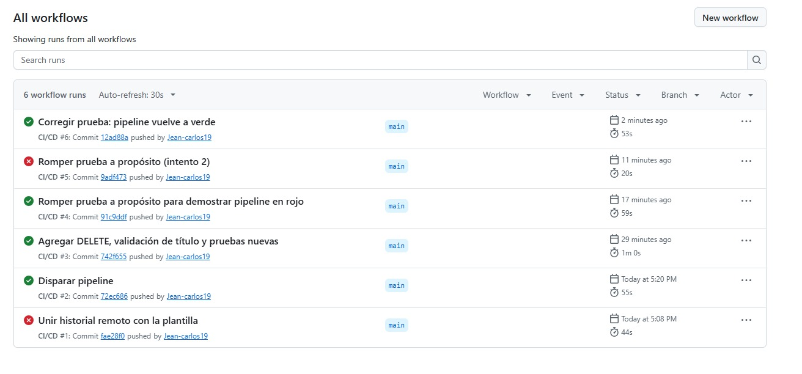
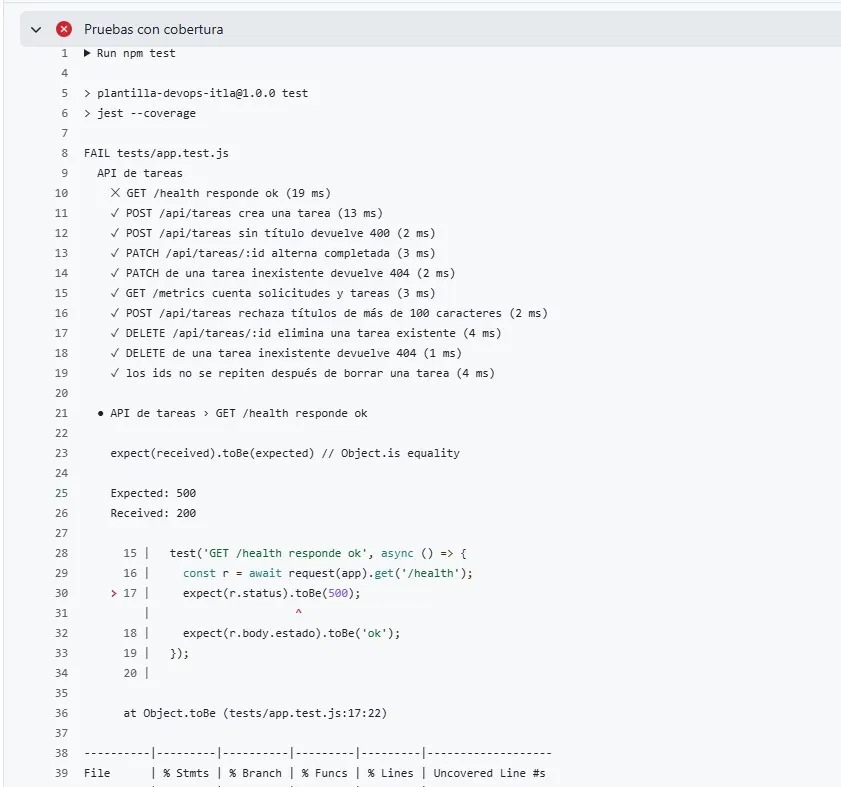
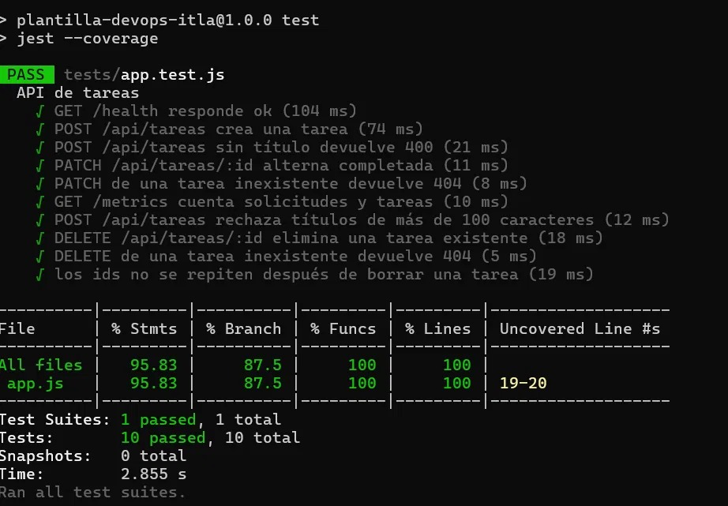
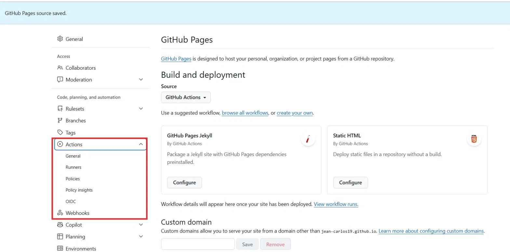
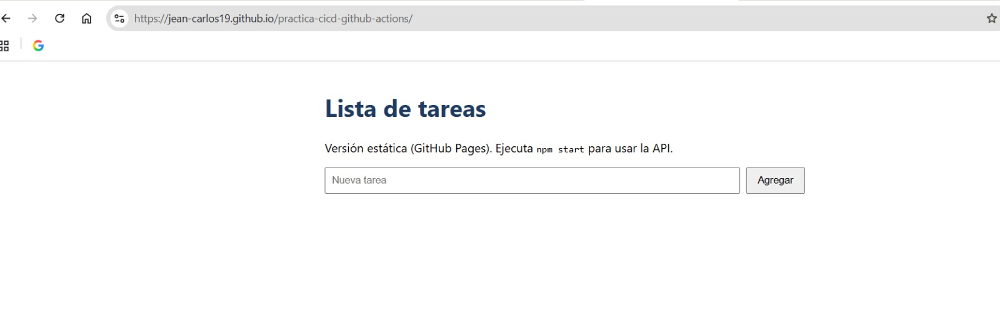

# Práctica 3 — Pipeline CI/CD con GitHub Actions

**Estudiante:** Jean Carlos Ogando
**Curso:** Electiva 1: Introducción a DevOps (ITLA 2026-C-3)
**Repositorio:** https://github.com/Jean-carlos19/practica-cicd-github-actions
**Sitio publicado:** https://jean-carlos19.github.io/practica-cicd-github-actions/

## Descripción

Aplicación web mínima (lista de tareas) con Node.js/Express, pruebas con Jest + Supertest, Dockerfile y un pipeline CI/CD en GitHub Actions que prueba la aplicación y despliega el frontend estático a GitHub Pages.

| Pieza | Archivo | Para qué sirve |
|---|---|---|
| App Node.js/Express | `src/app.js`, `src/server.js` | API de tareas + `/health` y `/metrics` |
| Frontend estático | `public/index.html` | Se publica en GitHub Pages |
| Pruebas | `tests/app.test.js` | Jest + Supertest con cobertura |
| Contenedor | `Dockerfile` | Imagen de producción con healthcheck |
| Pipeline | `.github/workflows/ci.yml` | Pruebas → build Docker → deploy a Pages |

## Ejecutar en local

```bash
npm install
npm test          # pruebas + cobertura
npm start         # http://localhost:3000
```

Endpoints: `GET /health`, `GET /metrics`, `GET/POST /api/tareas`, `PATCH /api/tareas/:id`, `DELETE /api/tareas/:id`.

Con Docker:

```bash
docker build -t tareas-devops .
docker run -p 3000:3000 tareas-devops
```

## Pipeline: explicación de cada etapa

El workflow (`.github/workflows/ci.yml`) se ejecuta en cada `push` y `pull_request` hacia `main`. Tiene dos jobs.

### Job 1: Build y pruebas (`build-test`)

| Paso | Qué hace |
|---|---|
| `actions/checkout@v4` | Descarga el código del repositorio en el runner. |
| `actions/setup-node@v4` | Instala Node.js 20. |
| `npm install` | Instala las dependencias (Express, Jest, Supertest). |
| Revisión estática (`npm run lint`) | Verifica que `src/app.js` y `src/server.js` no tengan errores de sintaxis. |
| Pruebas con cobertura (`npm test`) | Ejecuta Jest con cobertura. Si una prueba falla, el job termina en rojo. |
| Construir imagen Docker | Construye la imagen con el `Dockerfile`, etiquetada con el SHA del commit. |

### Job 2: Despliegue a GitHub Pages (`deploy-pages`)

- **`needs: build-test`**: solo corre si el job anterior pasó. Si las pruebas fallan, no se despliega.
- **`if`**: solo se ejecuta en `push` a `main`, no en pull requests.
- **Pasos**: `checkout` → `configure-pages` (prepara Pages) → `upload-pages-artifact` (empaqueta la carpeta `public`) → `deploy-pages` (publica el sitio y devuelve la URL).
- **Permisos** (`pages: write`, `id-token: write`): necesarios para que el workflow pueda publicar.

Nota: GitHub Pages solo sirve archivos estáticos, por eso el sitio publicado no muestra la lista de tareas; la API completa funciona con `npm start`.

## Cambios realizados en la Práctica 3

1. **Nuevo endpoint** `DELETE /api/tareas/:id` (devuelve la tarea eliminada o 404).
2. **Validación**: los títulos de más de 100 caracteres devuelven 400.
3. **Corrección de ids**: se usa un contador independiente (`siguienteId`) en vez de `tareas.length + 1`, para no repetir ids tras borrar tareas.
4. **4 pruebas nuevas**: título largo, borrar tarea existente, borrar tarea inexistente y ids sin repetirse. Total: 10 pruebas, cobertura de 95.83 % en sentencias y 100 % en funciones y líneas.

## Resumen del ciclo verde → rojo → verde

| Ejecución | Commit | Resultado | Motivo |
|---|---|---|---|
| #1 | Unir historial remoto con la plantilla | Rojo | GitHub Pages aún no estaba configurado. |
| #2 | Disparar pipeline | Verde | Línea base funcionando. |
| #3 | Agregar DELETE, validación y pruebas nuevas | Verde | Código y pruebas nuevas correctas. |
| #4 | Romper prueba a propósito para demostrar pipeline en rojo | Verde | El cambio no rompía ninguna prueba. |
| #5 | Romper prueba a propósito (intento 2) | **Rojo** | Se esperaba `500` en `/health` y se recibió `200`. El despliegue fue omitido. |
| #6 | Corregir prueba: pipeline vuelve a verde | Verde | Se restauró `toBe(200)`. |

## Guía de contribución

1. Crear una rama a partir de `main`.
2. Ejecutar `npm test` en local antes de hacer commit.
3. Abrir un pull request hacia `main`; el pipeline debe salir en verde.
4. Hacer merge solo si las pruebas pasan.

## Instrucciones de despliegue

1. En el repositorio: **Settings → Pages → Source: GitHub Actions**.
2. Hacer `push` a `main`.
3. En la pestaña **Actions**, esperar los dos jobs en verde; la URL del sitio aparece en el job *Despliegue a GitHub Pages*.

## Evidencia (capturas)

### Pipeline: verde → rojo → verde


### Fallo a propósito (ejecución #5)
El log muestra `Expected: 500` y `Received: 200`; el despliegue a Pages fue omitido.



### Pruebas locales y cobertura


### GitHub Pages


